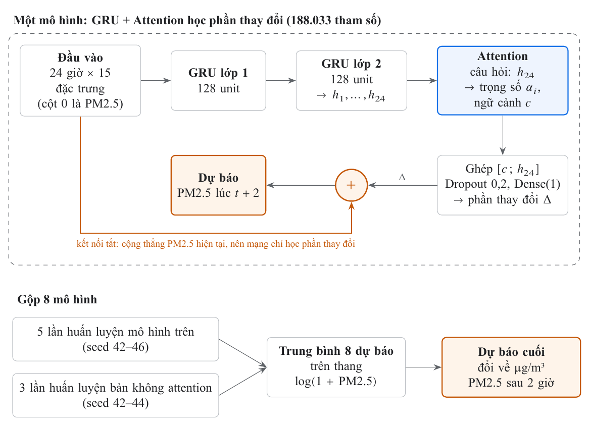
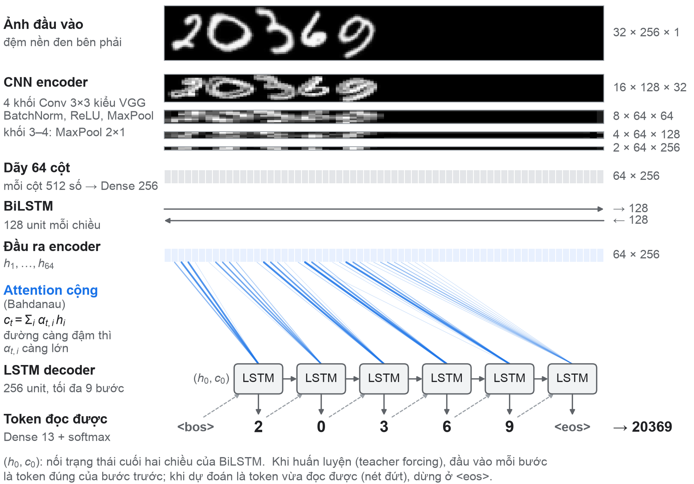

# Dự báo PM2.5 Hà Nội và đọc chuỗi chữ số viết tay

*Short-term PM2.5 forecasting for Hanoi and handwritten digit-string recognition with attention-based recurrent networks. Deep Learning final project.*

Đây là bài cuối kỳ môn Deep Learning, làm theo nhóm. Đề tài dùng hai bộ dữ liệu do nhóm tự xây dựng:

| Task | Bài toán | Dữ liệu |
|---|---|---|
| Task 1–2 | Dự báo nồng độ PM2.5 ở Hà Nội vài giờ tới. Task 1 dự báo một bước (2 giờ tới), Task 2 dự báo nhiều bước | Số liệu theo giờ từ Open-Meteo (khí tượng ERA5 và chất lượng không khí CAMS): bản 2023–2025 và bản mở rộng 08/2022–10/2026 |
| Task 3 | Đọc chuỗi 3–8 chữ số viết tay trong ảnh, ví dụ ra `"20369"` | Ảnh ghép từ chữ số MNIST, mỗi chuỗi do một người viết; sinh bằng script của nhóm |

Repo hiện có:
- gói dữ liệu chung của nhóm cho cả ba task;
- phần Task 1 (khám phá dữ liệu, mô hình, thí nghiệm, kết quả);
- toàn bộ phần Task 3 (notebook, script, kết quả);
- proposal của nhóm: bản đầu và bản cập nhật theo bước 1 giờ.

## Task 1: dự báo PM2.5 sau 2 giờ



Ở mỗi giờ, mô hình đọc 24 giờ gần nhất (PM2.5, PM10, NO2, 6 biến khí tượng, thời điểm trong ngày) và dự báo PM2.5 sau 2 giờ. Mô hình chính là **GRU + Attention học phần thay đổi**:
1. Hai lớp GRU (128 unit) đọc lần lượt 24 giờ.
2. Attention cộng (Bahdanau) cho mô hình nhìn lại cả 24 giờ và tự chọn giờ quan trọng.
3. PM2.5 hiện tại được cộng thẳng vào đầu ra (kết nối tắt như ResNet), nên mạng chỉ học phần thay đổi trong 2 giờ.

Dự báo cuối là trung bình của 8 lần huấn luyện: 5 seed của mô hình trên và 3 seed của bản không attention.

**Kết quả** trên tập test 07–12/2025 (4.416 giờ), và trên 01–10/2026 (dữ liệu chưa dùng lần nào, có trọn một mùa đông):

| Mô hình | RMSE test (µg/m³) | NSE test | RMSE 01–10/2026 |
|---|---:|---:|---:|
| Giữ nguyên giá trị hiện tại (persistence) | 15,55 | 0,765 | 14,87 |
| Hồi quy tuyến tính | 10,62 | 0,891 | 10,68 |
| LSTM + Attention (mô hình ban đầu) | 11,29 | 0,876 | 11,05 |
| **GRU + Attention học phần thay đổi, gộp 8 mô hình** | **9,04** | **0,921** | **9,31** |

- **Mô hình ban đầu thắng persistence nhưng thua hồi quy tuyến tính.** Sau hai vòng nâng cấp, mỗi bước chọn theo validation (mục 14 của notebook 02), mô hình cuối thắng chắc chắn hồi quy tuyến tính: bootstrap theo ngày cho RMSE thấp hơn 1,58, khoảng tin cậy 95% từ 1,23 đến 1,92.
- **Task 1 đã gần trần với dữ liệu hiện có:** vòng nâng cấp thứ hai chỉ giảm thêm 0,1 RMSE. Sai số còn lại dồn vào các giờ PM2.5 đổi nhanh và hai giờ CAMS nối lượt dự báo (7:00 và 19:00).
- **Bước 1 giờ không rò rỉ dữ liệu:** số theo giờ của CAMS trên Open-Meteo là số thật, không phải nội suy từ các mốc 3 giờ.

Notebook `01_task1_2_eda.ipynb` khám phá dữ liệu. Notebook `02_task1_model.ipynb` có các thí nghiệm E1–E3 và E1b, hai vòng nâng cấp N1–N10, trọng số attention, phân tích lỗi và bootstrap. Các bảng kết quả nằm trong `task1_outputs/results/`.

## Task 3: mô hình CNN + BiLSTM + LSTM decoder + Attention



Mô hình hoạt động qua ba bước:
1. CNN kiểu VGG biến ảnh 32 × 256 thành một dãy 64 cột, xếp từ trái sang phải.
2. BiLSTM đọc dãy cột này theo cả hai chiều.
3. LSTM decoder sinh lần lượt từng chữ số, dừng ở `<eos>`. Ở mỗi bước, attention cộng (Bahdanau) chỉ cho decoder biết cần nhìn vào cột nào.

Trong hình, các đường xanh là trọng số attention thật của mô hình khi đọc ảnh ví dụ.

**Kết quả trên 2.000 ảnh test v3** (mỗi chuỗi do một người viết; người viết của tập test không có trong tập train):

| Mô hình | Số tham số | Đọc đúng cả chuỗi | CER |
|---|---:|---:|---:|
| CNN + nhiều đầu softmax (mốc so sánh) | 9.709.429 | 76,75% | 6,05% |
| CNN + LSTM decoder + Attention (bỏ BiLSTM) | 2.056.013 | 79,50% | 8,03% |
| CNN + BiLSTM + LSTM decoder (bỏ attention) | 2.252.877 | 93,30% | 1,59% |
| **CNN + BiLSTM + LSTM decoder + Attention** | 2.318.669 | **94,10%** | **1,18%** |
| Mô hình trên, gộp 3 seed (ensemble) | 3 × 2.318.669 | 95,35% | 0,89% |
| Mô hình trên, huấn luyện với 60.000 ảnh thay vì 20.000 | 2.318.669 | **96,65%** | **0,63%** |

- **Độ tin cậy:** khoảng tin cậy 95% (bootstrap) của mô hình chính là 92,95–95,05%; chạy với ba seed được 94,35 ± 0,22%.
- **Quy đổi chuỗi ra số, theo từng chữ số:** R² = 0,970, NSE = 0,969, MAE = 0,053, RMSE = 0,504.
- **Ghép một người viết (v3) hay nhiều người viết (v2):** trên test v3, mô hình học trên v3 đếm đúng số chữ số hơn mô hình học trên v2 (8 so với 25 ảnh sai độ dài).
- **Beam search** (k = 3 và 5) chỉ sửa được 3/2.000 ảnh. **Tăng cường dữ liệu mạnh hơn** giảm học vẹt rõ nhưng chỉ tăng 0,95 điểm, chưa chắc chắn theo bootstrap.
- **Đọc kèm độ tự tin:** chuyển 10% ảnh kém tự tin nhất cho người kiểm tra thì độ chính xác trên phần còn lại là 98,1%.

Notebook `05_task3_model.ipynb` có thêm phân tích lỗi và bản đồ attention. Các bảng kết quả đầy đủ nằm trong `task3_outputs/results/`.

## Cấu trúc thư mục

```
.
├── 01_task1_2_eda.ipynb         Task 1–2: khám phá dữ liệu PM2.5 và khí tượng
├── 02_task1_model.ipynb         Task 1: mô hình mốc, các biến thể RNN, attention, thí nghiệm, hai vòng nâng cấp
├── task1_outputs/               Task 1: hình, bảng kết quả, lịch sử huấn luyện (trọng số không đăng kèm)
├── 04_task3_data.ipynb          Task 3: khám phá dữ liệu, kiểm tra cùng người viết, đệm ảnh, mã hoá nhãn, tăng cường dữ liệu
├── 05_task3_model.ipynb         Task 3: mô hình, huấn luyện, greedy/beam search, đánh giá, thí nghiệm so sánh, khoảng tin cậy
├── task3_model.py               Task 3: riêng mô hình chính dạng script (huấn luyện + đánh giá trên tập test)
├── task3_outputs/
│   ├── figures/                 hình dùng cho báo cáo
│   ├── results/                 bảng kết quả (CSV) và task3_summary.json
│   └── models/                  lịch sử huấn luyện từng epoch (*_history.json); trọng số không đăng kèm
├── FinalDeepData/               gói dữ liệu chung của nhóm, xem FinalDeepData/README.md
│   ├── common/                  data_utils.py (đọc dữ liệu), metrics.py (R², NSE, MAE, RMSE, chỉ số Task 3)
│   ├── task1_2/                 số liệu PM2.5 và khí tượng Hà Nội theo giờ: 2023–2025 (v1) và 08/2022–10/2026 (bản mở rộng)
│   └── task3/                   script sinh ảnh chuỗi chữ số (generate_data_v3.py) và kiểm tra người viết (check_writers.py)
├── Proposal_PM2.5_Ha_Noi_va_chuoi_so_viet_tay.pdf      proposal bản đầu
└── Proposal_PM2.5_Ha_Noi_va_chuoi_so_viet_tay_1h.pdf   proposal cập nhật: bước 1 giờ, mô hình cuối của Task 1
```

## Dữ liệu

- **Task 1–2:** dùng ngay file `FinalDeepData/task1_2/hanoi_hourly_2023_2025_v1.csv`. File có 26.304 giờ, không thiếu giờ nào và có sẵn cột chia train/validation/test theo thời gian. `FinalDeepData/README.md` mô tả từng cột, cách cắt cửa sổ trượt và mốc dự báo persistence cần vượt qua.
  - Bản mở rộng `hanoi_hourly_2022_2026_v2.csv` (08/2022–10/2026, 19 biến, có hướng gió) dùng cho phần nâng cấp của Task 1. Tải lại bằng `python FinalDeepData/task1_2/download_2022_2026.py`. Ở những giờ trùng nhau, các cột chung khớp hoàn toàn với bản 2023–2025.
- **Task 3:** bộ ảnh không có trong repo. Sinh lại bộ chính v3 bằng một lệnh, khoảng 20 giây:

  ```bash
  cd FinalDeepData/task3
  python generate_data_v3.py     # tự tải MNIST (11 MB) và nhãn mở rộng của QMNIST (1 MB), sinh 20.000 / 2.000 / 2.000 ảnh
  cd ../..
  ```

  - **Mỗi ảnh là chữ của một người viết.** MNIST không kèm mã người viết; script lấy mã người viết của từng ảnh MNIST từ QMNIST (Yadav & Bottou, 2019), rồi chỉ ghép chữ số của cùng một người vào một chuỗi. Train, validation và test dùng ba nhóm người viết khác nhau.
  - Hai bản cũ v1, v2 ghép mỗi chữ số từ một ảnh MNIST bất kỳ (trung bình 5,5 người viết mỗi ảnh); `check_writers.py` kiểm tra điều này. Bản v2 chỉ còn dùng ở mục 11 của notebook 05 để so sánh; sinh bằng `python generate_data.py && python generate_data_v2.py` (v2 dùng cách chia ảnh MNIST của v1). Thiếu v2 thì notebook bỏ qua mục 11.
  - Seed được cố định, nên nhãn, người viết và ảnh MNIST nguồn luôn giống hệt bộ nhóm đã dùng. Ảnh giống hệt từng pixel khi dùng cùng phiên bản Pillow (nhóm dùng Pillow 13, NumPy 2.5); phiên bản khác có thể lệch vài mức xám.
  - Bộ 60.000 ảnh train (`mnist_sequences_v3_big`) được notebook và `task3_model.py --data v3_big` tự sinh khi cần.

## Chạy code Task 1

Mở notebook từ thư mục gốc của repo, cùng môi trường Python như phần Task 3 dưới đây. `01_task1_2_eda.ipynb` chạy trong vài giây. Repo không kèm trọng số, nên `02_task1_model.ipynb` huấn luyện lại toàn bộ 131 mô hình, mất khoảng 4,3 giờ trên MacBook M4 Pro (Keras với PyTorch).

## Chạy code Task 3

Cần Python 3.10 trở lên:

```bash
pip install "keras>=3" tensorflow numpy pandas pillow matplotlib h5py
```

Code viết bằng Keras 3, nên cũng chạy được với PyTorch: cài `torch` rồi đặt `KERAS_BACKEND=torch`.

- **Notebook:** mở từ thư mục gốc của repo, sau khi đã sinh dữ liệu.
  - Repo không kèm trọng số, nên `05_task3_model.ipynb` huấn luyện 9 mô hình (8 mô hình trên v3 và mô hình so sánh trên v2), mất khoảng 4,5 giờ trên GPU Apple M4 Pro.
  - Đặt `RUN_EXPERIMENTS = False` để chỉ huấn luyện mô hình chính, khoảng 25 phút.
- **Script** (kết quả lưu vào `checkpoints/`):

  ```bash
  python task3_model.py                        # 20.000 ảnh v3, seed 42, tối đa 30 epoch
  python task3_model.py --data v3_big          # 60.000 ảnh v3
  python task3_model.py --data v2 --seed 43    # bộ v2 cũ (ghép nhiều người viết), seed khác
  ```

- **Google Colab:**
  1. Mở notebook: [](https://colab.research.google.com/github/haminh109/hanoi-pm25-and-digit-string-recognition/blob/main/05_task3_model.ipynb)
  2. Chọn *Runtime → Change runtime type → GPU*.
  3. Thêm một ô ở đầu notebook rồi chạy lần lượt:

  ```python
  !git clone -q https://github.com/haminh109/hanoi-pm25-and-digit-string-recognition.git
  %cd hanoi-pm25-and-digit-string-recognition
  !cd FinalDeepData/task3 && python generate_data_v3.py && python generate_data.py && python generate_data_v2.py
  ```

- **Máy Mac dùng Anaconda:** nếu `import tensorflow` bị treo (lỗi `mutex.cc ... Lock blocking`, do xung đột với `pyarrow`), dùng một môi trường mới không có `pyarrow`, hoặc chạy trên Colab.

## Ghi nguồn dữ liệu

- Số liệu Task 1–2: [Open-Meteo](https://open-meteo.com/), gồm Historical Weather API và Air Quality API. Dữ liệu chất lượng không khí lấy từ mô hình CAMS (Copernicus Atmosphere Monitoring Service). Dữ liệu dùng theo giấy phép CC BY 4.0.
- MNIST: LeCun, Y., Bottou, L., Bengio, Y., Haffner, P. (1998). Gradient-based learning applied to document recognition. *Proceedings of the IEEE*, 86(11).
- Mã người viết của ảnh MNIST: QMNIST, Yadav, C., Bottou, L. (2019). Cold case: the lost MNIST digits. *Advances in Neural Information Processing Systems 32*. https://github.com/facebookresearch/qmnist (giấy phép BSD).
